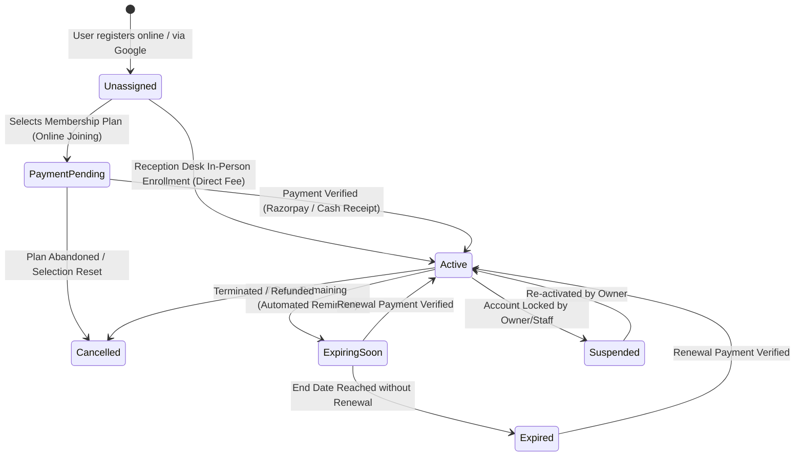

# Database Schema & Membership State Machine

> Gym Management System — Cloud Firestore Data Architecture & State Lifecycle Specification.

## 1. Membership & Payment State Machine

### State Definitions

| State | Scope | Description | Access Rights |
| :--- | :--- | :--- | :--- |
| `unassigned` | User Profile | Account created, no plan chosen yet. | Can browse public plans, edit own profile. |
| `payment_pending` | Membership / Profile | Plan chosen online; awaiting payment verification. | Cannot scan attendance QR until payment is confirmed. |
| `active` | Membership / Profile | Paid & verified membership; within valid date range. | Full gym floor, QR scan attendance, trainer workouts. |
| `expired` | Membership | Today's date > `endDate`. Historical record preserved. | Blocked at gate scan; prompted to renew. |
| `suspended` | User Profile | Staff or member account suspended by gym owner. | Access completely restricted. |
| `cancelled` | Membership | Membership revoked or refunded before expiry. | Inactive. |

---

## 2. Core Firestore Collections Reference

### `users` collection (`users/{uid}`)
| Field | Type | Description |
| :--- | :--- | :--- |
| `uid` | string | Firebase Auth UID (Document ID) |
| `email` | string | Normalized lowercase email address |
| `displayName` | string | Full name |
| `phone` | string \| null | Primary contact number |
| `role` | string | `'owner'` \| `'reception'` \| `'trainer'` \| `'member'` |
| `approvalStatus` | string | `'active'` \| `'pending'` \| `'suspended'` |
| `membershipStatus` | string \| null | `'none'` \| `'payment_pending'` \| `'active'` \| `'expired'` |
| `activeMembershipId`| string \| null | Reference to currently active or pending membership document |
| `gender` | string \| null | `'male'` \| `'female'` \| `'other'` |
| `dateOfBirth` | string \| null | `YYYY-MM-DD` |
| `emergencyContact` | map \| null | `{ name, phone, relation }` |
| `address` | string \| null | Residential address |
| `whatsappOptIn` | boolean | Consent for WhatsApp reminders & notices |
| `registeredBy` | string \| null | Staff UID if registered at reception desk |
| `createdAt` | string (ISO UTC) | Timestamp created |
| `updatedAt` | string (ISO UTC) | Timestamp last modified |

### `memberships` collection (`memberships/{membershipId}`)
| Field | Type | Description |
| :--- | :--- | :--- |
| `membershipId` | string | Auto-generated Firestore Document ID |
| `userId` | string | Reference to `users/{uid}` |
| `planId` | string | Reference to `membershipPlans/{planId}` |
| `planName` | string | Snapshot of plan name at creation (e.g. "3 Months Pro") |
| `durationDays` | number | Number of days (e.g. 30, 90, 180, 365) |
| `priceInPaise` | number | Plan price in integer paise (₹3,999 = `399900`) |
| `startDate` | string (ISO UTC) | Membership validity start date |
| `endDate` | string (ISO UTC) | Membership validity expiration date |
| `status` | string | `'payment_pending'` \| `'active'` \| `'expired'` \| `'cancelled'` |
| `paymentStatus` | string | `'pending'` \| `'paid'` \| `'refunded'` |
| `paymentId` | string \| null | Reference to `payments/{paymentId}` |
| `renewedFrom` | string \| null | Previous `membershipId` (preserves renewal chain) |
| `createdBy` | string | Member UID (online) or Staff UID (reception) |
| `createdAt` | string (ISO UTC) | Creation timestamp |
| `updatedAt` | string (ISO UTC) | Modification timestamp |

### `membershipPlans` collection (`membershipPlans/{planId}`)
| Field | Type | Description |
| :--- | :--- | :--- |
| `planId` | string | Unique slug ID (`plan-3-months`, `plan-12-months`) |
| `name` | string | Plan title |
| `durationMonths` | number | Duration in calendar months |
| `durationDays` | number | Exact validity days |
| `priceInPaise` | number | Price stored in integer paise |
| `features` | array<string> | List of plan benefits |
| `badge` | string \| null | Highlight tag (`"Popular"`, `"Best Value"`) |
| `isActive` | boolean | Visibility toggle for public & online joining |
| `displayOrder` | number | Ordering index on UI cards |
| `createdAt` | string (ISO UTC) | Creation timestamp |
| `updatedAt` | string (ISO UTC) | Modification timestamp |

---

## 3. Monetary & Timezone Conventions (ADR Compliance)

- **Monetary Storage (ADR 001):** All currency amounts MUST be represented as **integer paise** (1 INR = 100 paise). Floating-point rupee numbers are strictly forbidden in Firestore to eliminate rounding errors.
- **Date & Time Standards:** All timestamps in Firestore documents are stored in ISO 8601 UTC strings (`new Date().toISOString()`) or Firestore Timestamp objects.
- **Display Timezone:** Rendered according to the gym operating timezone configured in `gymSettings` (default: `Asia/Kolkata` / IST).
- **History Preservation:** When memberships renew or change, existing records are never overwritten; a new `membership` document is inserted with `renewedFrom` pointing to the previous membership ID.
