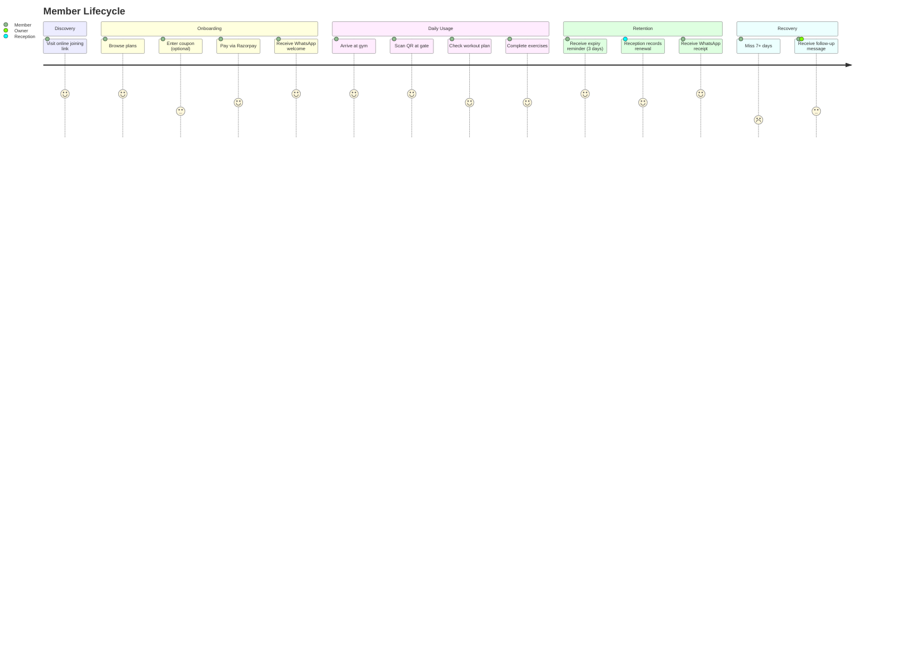
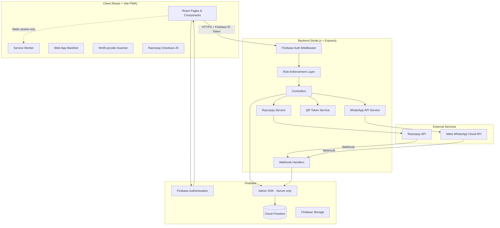
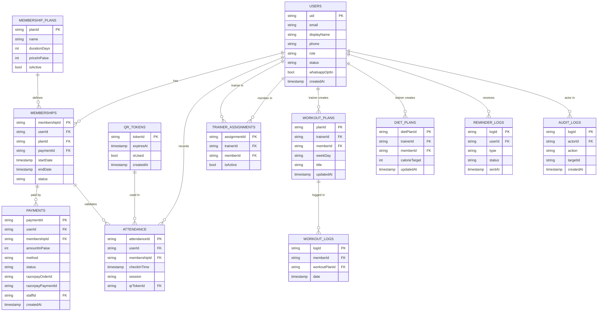
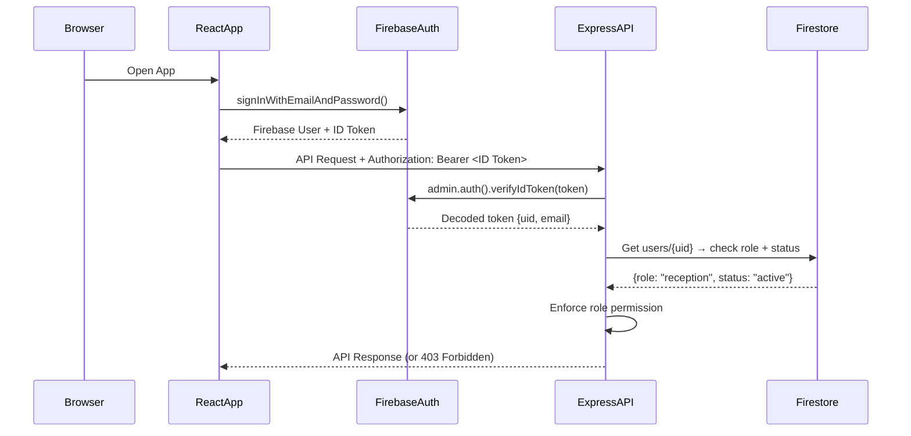
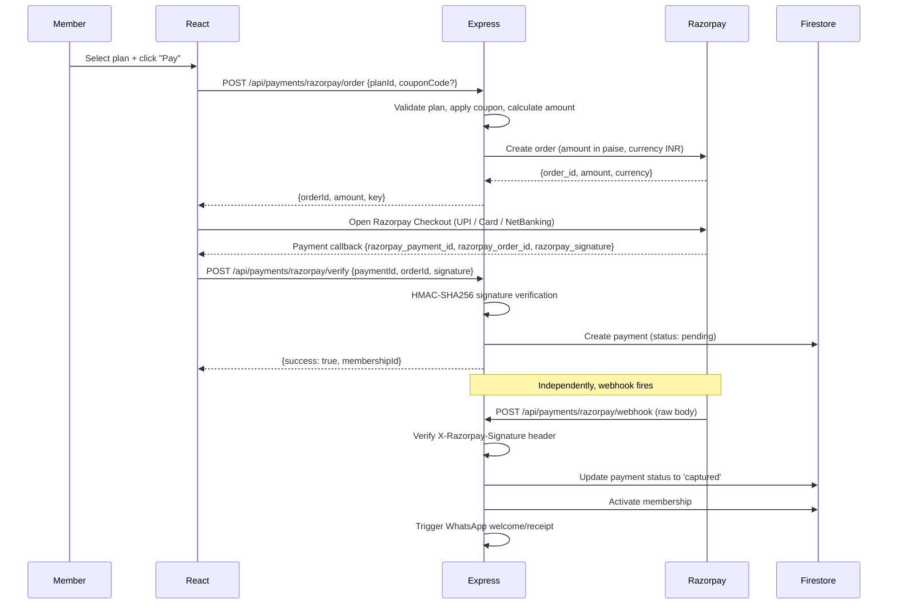
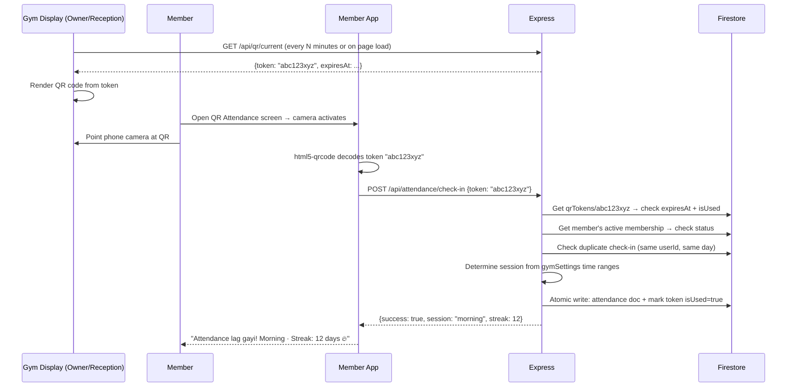
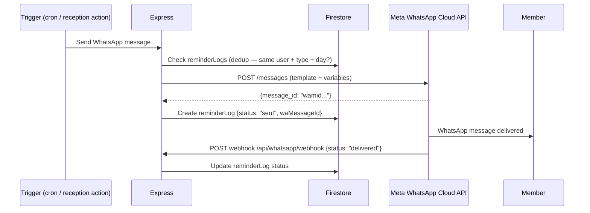
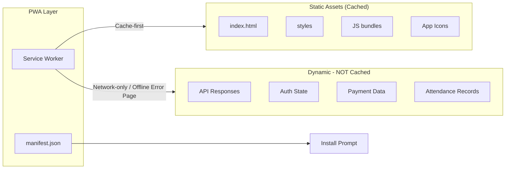
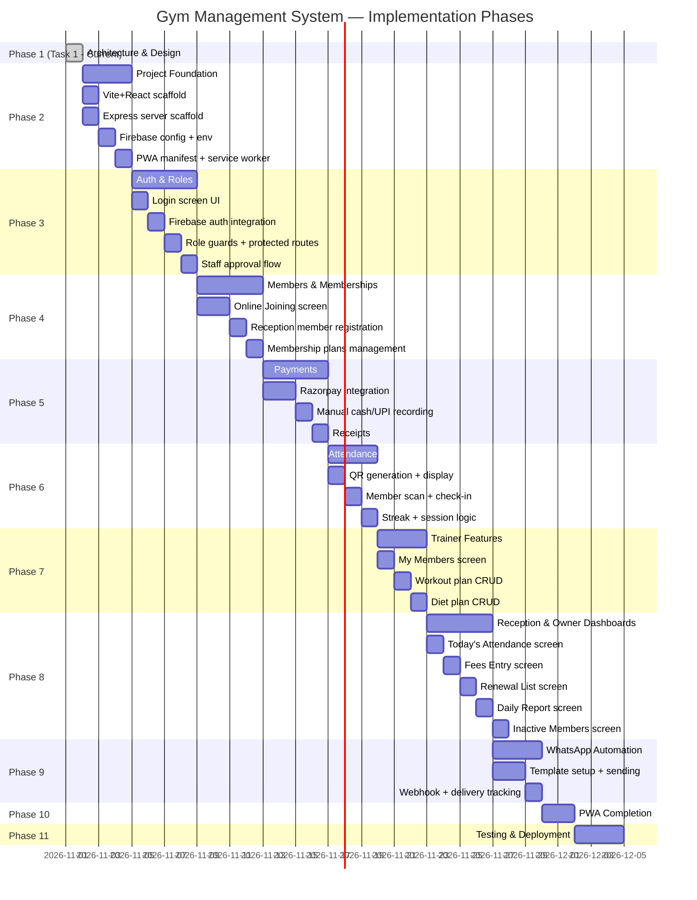

# Task 1 — Architecture & Design Plan
## Gym Management System · PWS Coding Blueprint

---

> [!IMPORTANT]
> This is a **planning-only document**. No code will be written until you approve this architecture.
> Review each section and give feedback before we proceed to Phase 2.

---

## 1. PDF Analysis — All 16 Pages

| Page | Content |
|------|---------|
| 1 | Cover — App overview, daily report mockup, Owner dashboard |
| 2 | 3 core business problems: manual fee registers, missed renewals, ghost members |
| 3 | Solution overview: 1 app, 4 roles, 11 screens. Member journey (5 steps) + screen map |
| 4 | Screen 1 — Online Joining (Member): plan selection, Razorpay, welcome message |
| 5 | Screen 2 — QR Attendance (Member): scan gate QR, streak, morning/evening session |
| 6 | Screen 3 — Workout Plan (Member): daily exercises, sets/reps, completion ticks |
| 7 | Screen 4 — Today's Attendance (Reception): total count, M/E split, per-member entry time |
| 8 | Screen 5 — Fees Entry (Reception): member search, plan, cash/UPI, WhatsApp receipt |
| 9 | Screen 6 — Renewal List (Reception): expiring this week, remaining days, bulk reminder |
| 10 | Screen 7 — My Members (Trainer): assigned list, goal, weight delta, weekly attendance |
| 11 | Screen 8 — Diet Plan (Trainer): macros, per-meal breakdown, send to member |
| 12 | Screen 9 — Daily Report (Owner): fees, attendance, new members, renewals, weekly chart |
| 13 | Screen 10 — Inactive Members (Owner): absent 7+ days, last visit, one-tap message |
| 14 | Screen 11 — Login (All): mobile + OTP *(Note: README says email+password — see §13)* |
| 15 | Future features: WhatsApp auto, payment links, RFID, multi-branch, Hindi/English |
| 16 | Project pitch: 10-min call, go-live process |

---

## 2. All 11 Screens — Detailed Breakdown

### Screen 1 — Online Joining `[Member]`
- Display available membership plans (1M / 3M / 12M with price and perks)
- Optional coupon/discount code
- Select plan → trigger Razorpay checkout
- On success: create `memberships` + `payments` records, send WhatsApp welcome

### Screen 2 — QR Attendance `[Member]`
- Display camera viewfinder with `html5-qrcode`
- Scan gym's rotating QR token from entrance display
- POST token to backend → server validates + records check-in
- Show streak count, weekly calendar, session (morning / evening)

### Screen 3 — Workout Plan `[Member]`
- Fetch today's workout assigned by trainer
- List exercises with sets × reps
- Tick each exercise complete; progress bar updates
- Optional: video link per exercise

### Screen 4 — Today's Attendance `[Reception]`
- Total check-ins for today
- Morning / Evening split counters
- Scrollable list: avatar, name, role, entry time
- Trainers visually tagged separately

### Screen 5 — Fees Entry `[Reception]`
- Search member by name/phone
- View current plan expiry status
- Select new plan → auto-calculate amount & validity dates
- Toggle Cash / UPI
- Submit → record payment, extend membership, send WhatsApp receipt

### Screen 6 — Renewal List `[Reception]`
- Members whose plan expires within 7 days
- Sorted by days remaining (soonest first)
- Per-row: name, plan type, days left
- "Send all reminders" bulk action → WhatsApp message

### Screen 7 — My Members `[Trainer]`
- Trainer's assigned member list
- Per-card: name, goal (fat loss / muscle gain / fitness), weight delta (kg), weekly attendance days
- Tap member → detail view (weight log, attendance history)

### Screen 8 — Diet Plan `[Trainer]`
- Select assigned member
- Set calorie target + macros (protein / carbs / fat in grams)
- Add meals (Breakfast / Lunch / Snack / Dinner) with kcal and food items
- Save plan to Firestore; "Send to member" → WhatsApp

### Screen 9 — Daily Report `[Owner]`
- Total fees collected today (Cash + UPI breakdown)
- Pending dues amount
- Today's attendance count
- New members today, renewals today
- Bar/line chart: this week's daily attendance
- Optional: monthly report download

### Screen 10 — Inactive Members `[Owner]`
- Members absent 7+ days with active memberships
- Sorted by days absent (longest first)
- Pre-filled follow-up message text
- "Send all" → bulk WhatsApp

### Screen 11 — Login `[All]`
- Email + password form (Firebase Auth — per README; PDF shows OTP but README overrides)
- Role selection display (role stored server-side, not client-supplied)
- Forgot password link
- Logout from any authenticated screen

---

## 3. User Journey Diagram



---

## 4. System Architecture



### Architecture Decisions
| Decision | Choice | Reason |
|----------|--------|--------|
| Frontend framework | React + Vite | Per README spec |
| Backend | Node.js + Express | Per README spec |
| Database | Cloud Firestore | Per README spec; NoSQL fits gym domain |
| Auth | Firebase Authentication (email/password) | Per README (overrides PDF OTP) |
| Payments | Razorpay | Per README spec |
| Messaging | Meta WhatsApp Business Cloud API | Per README spec |
| CSS | Vanilla CSS + CSS Variables | Per README spec; no Tailwind |
| Component icons | Lucide React | Per README spec |
| Charts | Recharts | Per README spec |
| QR scanning | html5-qrcode | Per README spec |

---

## 5. Firestore Data Model

### `users` collection
```
{
  uid: string                  // Firebase Auth UID (= document ID)
  email: string
  displayName: string
  phone: string
  role: 'owner' | 'reception' | 'trainer' | 'member'
  status: 'active' | 'pending' | 'suspended'
  profilePhotoUrl?: string     // Firebase Storage URL
  createdAt: Timestamp
  updatedAt: Timestamp
  whatsappOptIn: boolean
  createdBy?: string           // uid of creator (for staff)
  approvedBy?: string          // uid of owner who approved
  approvedAt?: Timestamp
}
```

### `membershipPlans` collection
```
{
  planId: string               // document ID
  name: string                 // "1 Month", "3 Months", "12 Months"
  durationDays: number         // 30, 90, 365
  priceInPaise: number         // e.g. 399900 for ₹3,999
  features: string[]           // ["Gym", "Cardio", "Diet Plan"]
  isActive: boolean
  displayOrder: number
  createdAt: Timestamp
}
```

### `memberships` collection
```
{
  membershipId: string         // document ID
  userId: string               // ref → users
  planId: string               // ref → membershipPlans
  startDate: Timestamp
  endDate: Timestamp
  status: 'active' | 'expired' | 'cancelled'
  paymentId?: string           // ref → payments
  createdBy: string            // uid (member self or reception staff)
  createdAt: Timestamp
  renewedFrom?: string         // previous membershipId for renewal chain
}
```

### `payments` collection
```
{
  paymentId: string            // document ID
  userId: string               // ref → users (member)
  membershipId?: string        // ref → memberships
  amountInPaise: number
  method: 'razorpay' | 'cash' | 'upi_manual'
  status: 'pending' | 'captured' | 'failed' | 'refunded'
  razorpayOrderId?: string
  razorpayPaymentId?: string
  razorpaySignature?: string
  staffId?: string             // for cash/UPI recorded by reception
  notes?: string
  createdAt: Timestamp
  updatedAt: Timestamp
}
```

### `attendance` collection
```
{
  attendanceId: string         // document ID
  userId: string               // ref → users (member)
  membershipId: string         // ref → memberships (for validity check)
  checkInTime: Timestamp       // server-generated
  session: 'morning' | 'evening'
  qrTokenId: string            // which QR token was used
  gymId: string                // for future multi-branch
  createdAt: Timestamp
}
```

### `qrTokens` collection
```
{
  tokenId: string              // document ID = the token value (short UUID)
  expiresAt: Timestamp         // short-lived: 5–10 minutes
  createdAt: Timestamp
  isUsed: boolean              // prevent replay attacks
}
```

### `trainerAssignments` collection
```
{
  assignmentId: string
  trainerId: string            // ref → users (role=trainer)
  memberId: string             // ref → users (role=member)
  assignedAt: Timestamp
  assignedBy: string           // ref → users (owner/reception)
  isActive: boolean
}
```

### `workoutPlans` collection
```
{
  planId: string
  trainerId: string
  memberId: string
  weekDay: 'mon'|'tue'|'wed'|'thu'|'fri'|'sat'|'sun' | 'all'
  title: string                // e.g. "Chest + Triceps"
  exercises: [
    {
      name: string
      sets: number
      reps: number | string    // "10" or "45 sec"
      videoUrl?: string
    }
  ]
  createdAt: Timestamp
  updatedAt: Timestamp
}
```

### `workoutLogs` collection
```
{
  logId: string
  memberId: string
  workoutPlanId: string
  date: Timestamp              // date of workout
  completedExercises: string[] // exercise names ticked
  completedAt?: Timestamp
}
```

### `dietPlans` collection
```
{
  dietPlanId: string
  trainerId: string
  memberId: string
  calorieTarget: number
  protein: number              // grams
  carbs: number                // grams
  fat: number                  // grams
  meals: [
    {
      mealType: 'breakfast'|'lunch'|'snack'|'dinner'
      calories: number
      items: string[]
    }
  ]
  createdAt: Timestamp
  updatedAt: Timestamp
}
```

### `notifications` collection
```
{
  notificationId: string
  userId: string               // recipient
  type: 'renewal_reminder'|'payment_confirmed'|'workout_assigned'|'diet_assigned'|'inactive_alert'
  title: string
  body: string
  isRead: boolean
  createdAt: Timestamp
}
```

### `reminderLogs` collection
```
{
  logId: string
  userId: string               // recipient member
  type: 'welcome'|'receipt'|'renewal_reminder'|'inactive_followup'
  waMessageId?: string         // Meta API message ID
  status: 'sent'|'delivered'|'read'|'failed'
  sentAt: Timestamp
  updatedAt: Timestamp
  sentBy?: string              // staff uid for manual sends
}
```

### `gymSettings` collection (single document: "main")
```
{
  gymName: string
  logoUrl?: string
  address: string
  phone: string
  morningSessionStart: string  // "06:00"
  morningSessionEnd: string    // "12:00"
  eveningSessionStart: string  // "16:00"
  eveningSessionEnd: string    // "22:00"
  qrRefreshIntervalSeconds: number  // e.g. 300
  updatedAt: Timestamp
  updatedBy: string
}
```

### `coupons` collection
```
{
  couponId: string
  code: string                 // unique uppercase e.g. "GYM2024"
  discountType: 'percent' | 'flat'
  discountValue: number        // percent (10) or paise (50000)
  maxUses: number
  usedCount: number
  validUntil: Timestamp
  isActive: boolean
  createdBy: string
  createdAt: Timestamp
}
```

### `auditLogs` collection
```
{
  logId: string
  actorId: string              // uid of user performing action
  actorRole: string
  action: string               // e.g. "STAFF_APPROVED", "PAYMENT_RECORDED", "MEMBER_SUSPENDED"
  targetId?: string            // uid or document ID of the affected entity
  targetType?: string          // "user", "payment", "membership"
  metadata?: object            // action-specific details
  createdAt: Timestamp
}
```

---

## 6. Mermaid ERD



---

## 7. REST API Endpoints

### Auth
| Method | Endpoint | Role | Description |
|--------|----------|------|-------------|
| POST | `/api/auth/verify-token` | All | Verify Firebase ID token; return role + status |
| POST | `/api/auth/register-staff` | Public | Self-register as reception/trainer (pending) |
| POST | `/api/auth/forgot-password` | Public | Trigger Firebase password reset email |

### Users / Staff Management
| Method | Endpoint | Role | Description |
|--------|----------|------|-------------|
| GET | `/api/users/me` | All | Get own profile |
| PUT | `/api/users/me` | All | Update own profile |
| GET | `/api/users/pending-staff` | Owner | List pending staff approvals |
| POST | `/api/users/:uid/approve` | Owner | Approve a pending staff member |
| POST | `/api/users/:uid/suspend` | Owner | Suspend a user |
| POST | `/api/users` | Owner | Owner-created staff account |

### Membership Plans
| Method | Endpoint | Role | Description |
|--------|----------|------|-------------|
| GET | `/api/plans` | All | List active plans (public) |
| POST | `/api/plans` | Owner | Create a plan |
| PUT | `/api/plans/:id` | Owner | Update a plan |
| DELETE | `/api/plans/:id` | Owner | Deactivate a plan |

### Members
| Method | Endpoint | Role | Description |
|--------|----------|------|-------------|
| GET | `/api/members` | Owner, Reception, Trainer | List members (paginated) |
| GET | `/api/members/:uid` | Owner, Reception, Trainer, self | Member profile + active membership |
| POST | `/api/members` | Reception | Register member manually |
| GET | `/api/members/expiring` | Owner, Reception | Members expiring within N days |
| GET | `/api/members/inactive` | Owner | Members absent 7+ days |

### Memberships
| Method | Endpoint | Role | Description |
|--------|----------|------|-------------|
| POST | `/api/memberships` | Reception, Member (self-join) | Create/renew membership |
| GET | `/api/memberships/:id` | Owner, Reception, self | Membership detail |

### Payments
| Method | Endpoint | Role | Description |
|--------|----------|------|-------------|
| POST | `/api/payments/razorpay/order` | Member | Create Razorpay order |
| POST | `/api/payments/razorpay/verify` | Member | Verify signature after Checkout |
| POST | `/api/payments/razorpay/webhook` | Razorpay | Webhook (raw body, signature verified) |
| POST | `/api/payments/manual` | Reception | Record cash or manual UPI |
| GET | `/api/payments` | Owner | Payment history (date range) |
| GET | `/api/payments/:id/receipt` | Owner, Reception, self | Payment receipt data |

### Attendance
| Method | Endpoint | Role | Description |
|--------|----------|------|-------------|
| POST | `/api/attendance/check-in` | Member | Submit QR token → server validates |
| GET | `/api/attendance/today` | Owner, Reception | Today's check-ins |
| GET | `/api/attendance/member/:uid` | All (own) | Member attendance history |
| GET | `/api/attendance/streak/:uid` | All (own) | Streak count |

### QR Tokens
| Method | Endpoint | Role | Description |
|--------|----------|------|-------------|
| GET | `/api/qr/current` | Owner, Reception (display screen) | Get current active QR token value |
| POST | `/api/qr/generate` | Cron / Owner | Rotate QR token |

### Trainer
| Method | Endpoint | Role | Description |
|--------|----------|------|-------------|
| GET | `/api/trainer/my-members` | Trainer | Assigned members with progress |
| POST | `/api/trainer/assign` | Owner, Reception | Assign trainer to member |
| GET | `/api/workout-plans/:memberId` | Trainer, Member | Get workout plan |
| PUT | `/api/workout-plans/:memberId` | Trainer | Save/update workout plan |
| POST | `/api/workout-logs` | Member | Log workout completion |
| GET | `/api/diet-plans/:memberId` | Trainer, Member | Get diet plan |
| PUT | `/api/diet-plans/:memberId` | Trainer | Save/update diet plan |

### Reports
| Method | Endpoint | Role | Description |
|--------|----------|------|-------------|
| GET | `/api/reports/daily` | Owner | Daily revenue, attendance, new members |
| GET | `/api/reports/weekly-chart` | Owner | This week's attendance by day |

### WhatsApp
| Method | Endpoint | Role | Description |
|--------|----------|------|-------------|
| POST | `/api/whatsapp/send-receipt/:paymentId` | Reception | Send payment receipt |
| POST | `/api/whatsapp/send-reminder/:userId` | Reception, Owner | Send renewal or inactive reminder |
| POST | `/api/whatsapp/send-bulk-reminders` | Reception, Owner | Bulk send |
| POST | `/api/whatsapp/webhook` | Meta | Incoming webhook (status updates) |

### Gym Settings
| Method | Endpoint | Role | Description |
|--------|----------|------|-------------|
| GET | `/api/settings` | All authenticated | Get gym settings |
| PUT | `/api/settings` | Owner | Update gym settings |

### Coupons
| Method | Endpoint | Role | Description |
|--------|----------|------|-------------|
| POST | `/api/coupons/validate` | Member | Validate coupon code |
| POST | `/api/coupons` | Owner | Create coupon |
| GET | `/api/coupons` | Owner | List all coupons |

---

## 8. Authentication & Authorization



### Key Rules
- **Never trust a role from the client.** Role is always read from `users/{uid}` in Firestore by the Express server.
- **Pending staff cannot access protected routes.** Status check runs on every request.
- **Public registration** cannot set `role: "owner"` — server ignores and defaults to `pending` member/staff.
- **Token expiry**: Firebase ID tokens expire in 1 hour; React SDK auto-refreshes silently.
- **Protected routes** in React: `ProtectedRoute` component checks auth state; redirects to login if unauthenticated.
- **Role-based routing**: After login, server returns role; React router guards render role-appropriate dashboard.

---

## 9. Razorpay Payment Flow



**Key rules:**
- Membership is activated **only** after webhook confirms capture
- Webhook handler is idempotent (check if already processed before updating)
- Razorpay secret key never leaves the server
- Store `razorpayOrderId`, `razorpayPaymentId`, `razorpaySignature` in the payment document

---

## 10. QR Attendance Flow



**Key rules:**
- Tokens rotate every 5–10 minutes (configurable in `gymSettings`)
- One check-in per member per day (duplicate rejected with 409)
- Token expiry checked server-side (not trusted from client)
- Server timestamp used for `checkInTime`
- Offline = no check-in (camera + server response required)

---

## 11. WhatsApp Automation

### Message Types & Templates
| Template Name | Trigger | Recipient |
|--------------|---------|-----------|
| `gym_welcome` | Member joins (Razorpay webhook captured) | New member |
| `payment_receipt` | Payment recorded (Razorpay or manual) | Member |
| `renewal_reminder` | 3 days before expiry (cron) or manual | Expiring member |
| `membership_expired` | Day of expiry | Member |
| `inactive_followup` | Manual trigger from Owner screen | 7+ day absent member |

### Message Flow


**Key rules:**
- Only send to users with `whatsappOptIn: true`
- Use **approved Meta message templates** for all proactive messages
- Verify all incoming webhooks using `X-Hub-Signature-256`
- Access tokens stored in server `.env` only
- `reminderLogs` prevents duplicate sends (same type, same user, same day)

---

## 12. PWA Architecture



### PWA Checklist
- [ ] `manifest.json` with `name`, `short_name`, `icons` (192×192, 512×512), `theme_color` (#0a0f1e), `background_color` (#0a0f1e), `display: standalone`
- [ ] Service worker registered via Vite PWA plugin (`vite-plugin-pwa`)
- [ ] Offline fallback page (`/offline.html`) shown when network unavailable
- [ ] Cache-first for static assets; network-only for API calls
- [ ] HTTPS required in production (camera + service workers)
- [ ] Responsive: mobile (primary), tablet, desktop

---

## 13. Unresolved Decisions & Risks

| # | Decision / Risk | Details | Recommendation |
|---|----------------|---------|----------------|
| 1 | **Login method mismatch** | PDF shows Mobile OTP; README says email+password | ✅ Use email+password per README. Note for the client. |
| 2 | **QR display screen** | Who/what displays the gym entrance QR? A dedicated TV/tablet? The reception screen? | Assume Reception screen shows a "Display QR" mode (full-screen QR with countdown timer) |
| 3 | **Multi-branch** | Listed as future feature (PDF p.15). Do we scaffold for it now? | Add `gymId` field to relevant docs but don't build branch UI yet |
| 4 | **WhatsApp opt-in consent** | Must comply with Meta policies; how is opt-in collected? | Checkbox during online joining + footer disclaimer |
| 5 | **Coupon system** | Listed as optional. Should we build it? | ✅ Build basic coupon validation (simple, low-risk) |
| 6 | **Monthly report download** | Optional per PDF. PDF format or just UI? | Defer to a later phase; not in MVP |
| 7 | **Razorpay test vs. live** | Dev should use Razorpay Test mode | Use test keys in `.env.example`; document how to switch |
| 8 | **WhatsApp template approval** | Templates must be pre-approved by Meta (can take days) | Set up dummy/placeholder templates in dev; document template setup |
| 9 | **RFID / Biometric** | Future feature. Ignore for now | No scaffolding needed |
| 10 | **Exercise video links** | Optional per PDF. External URL or Firebase Storage? | External YouTube URL (string) for now; simplest approach |
| 11 | **Recurring QR rotation** | Server cron? Client polling? | Client polls `/api/qr/current` every 5 min; server sets expiry |
| 12 | **Offline workout logs** | Workout completion while offline? | Show offline message; require connectivity (attendance and payments must be server-confirmed anyway) |

---

## 14. Implementation Roadmap



### Phase Summary Table
| Phase | Focus | Key Output |
|-------|-------|------------|
| ✅ 1 | Architecture | This document |
| 2 | Project Foundation | Scaffold: Vite/React + Express + Firebase + PWA base |
| 3 | Auth & Roles | Login screen, protected routes, staff approval |
| 4 | Members & Memberships | Online joining, plan selection, member registration |
| 5 | Payments | Razorpay order/verify/webhook, manual cash/UPI |
| 6 | Attendance | QR generation, scan, check-in, streak |
| 7 | Trainer Features | My Members, Workout Plan, Diet Plan |
| 8 | Dashboards | Today's Attendance, Fees Entry, Renewal List, Daily Report, Inactive Members |
| 9 | WhatsApp | Templates, sending, webhooks, dedup |
| 10 | PWA Completion | Full installability, offline fallback |
| 11 | Testing & Deploy | Security, integration, responsive, production config |

---

## ✅ Approval Checklist

Before proceeding to Phase 2, please confirm:

- [ ] **Login method**: Email + password (overriding PDF's OTP) — acceptable?
- [ ] **QR display**: Reception screen shows entrance QR in full-screen mode — acceptable?
- [ ] **Coupon system**: Build basic coupon support in Phase 4 — acceptable?
- [ ] **Offline behavior**: All sensitive ops (attendance, payment) require connectivity — acceptable?
- [ ] **WhatsApp**: Requires Meta-approved templates; we'll mock in dev — acceptable?
- [ ] **Tech stack confirmed**: React + Vite + Express + Firestore + Razorpay + Meta WhatsApp API
- [ ] **Any other requirements** not captured above?
